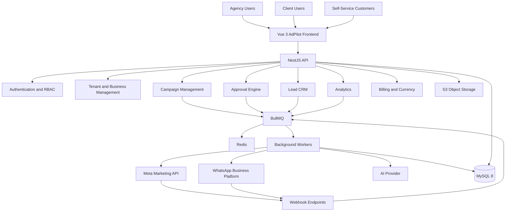

# ADPILOT
# Technical Architecture & Development Implementation Plan

**Version:** 2.0  
**Document Type:** Technical Architecture and Development Blueprint  
**Backend:** NestJS + TypeScript  
**Frontend:** Vue 3 + TypeScript  
**Database:** MySQL 8  
**Queue:** Redis + BullMQ  
**Initial Advertising Integration:** Meta Marketing API  
**Initial Messaging Integration:** WhatsApp Business Platform  
**Deployment:** Ubuntu + Nginx + PM2 / Docker-compatible architecture

---

# 1. Technical Overview

## 1.1 Objective

This document defines the technical architecture, application structure, database design, integrations, security model, and phased development plan for AdPilot.

The architecture must support:

- Agency-managed advertising.
- Self-service advertising.
- Hybrid agency-client operations.
- Multiple agencies and businesses.
- Client-owned advertising assets.
- Meta advertising integrations.
- WhatsApp Business messaging.
- Background processing and automation.
- AI recommendations.
- Multi-currency financial reporting.
- Future Google Ads and TikTok Ads integrations.

## 1.2 Architecture Principles

1. Multi-tenant by design.
2. Shared advertising engine for all operating modes.
3. Client-owned advertising assets.
4. Provider-independent integration architecture.
5. API-first backend.
6. Asynchronous processing for external API operations.
7. Approval-based automation.
8. Secure credential management.
9. Idempotent background processing.
10. Auditable financial and advertising operations.
11. Modular architecture with clear domain boundaries.
12. Expandable platform integrations.

---

# 2. Technology Stack

| Layer | Technology |
|---|---|
| Backend | NestJS |
| Language | TypeScript |
| Frontend | Vue 3 |
| Frontend Language | TypeScript |
| Build Tool | Vite |
| UI Framework | Vuetify 3 |
| State Management | Pinia |
| Database | MySQL 8 |
| ORM | TypeORM |
| Queue | BullMQ |
| Queue Storage | Redis |
| Authentication | JWT / Secure session strategy |
| API Documentation | Swagger / OpenAPI |
| File Storage | AWS S3-compatible storage |
| Reverse Proxy | Nginx |
| Process Management | PM2 or Docker |
| Logging | Structured application logging |
| Testing | Jest, Supertest, Vitest |
| Version Control | Git |

The system should use a modular monolith initially rather than premature microservices. Domain boundaries must remain clear so services can be extracted later if required.

---

# 3. High-Level Architecture



---

# 4. Multi-Tenant Architecture

## 4.1 Core Structure

AdPilot must support two primary customer entry points:

1. Agency organizations.
2. Independent business customers.

Both must use the same underlying advertising services.

Recommended logical structure:

```text
AdPilot Platform
│
├── Agency Organizations
│   ├── Agency Users
│   ├── Agency Roles
│   └── Client Businesses
│       ├── Client Users
│       ├── Meta Integrations
│       ├── Facebook Pages
│       ├── Instagram Accounts
│       ├── Advertising Accounts
│       ├── Campaigns
│       ├── Leads
│       └── Reports
│
└── Independent Businesses
    ├── Business Users
    ├── Business Roles
    ├── Meta Integrations
    ├── Facebook Pages
    ├── Instagram Accounts
    ├── Advertising Accounts
    ├── Campaigns
    ├── Leads
    └── Reports
```

## 4.2 Important Data Model Decision

Do not make the agency the owner of client advertising assets.

Use separate relationships for:

- Platform tenant.
- Agency organization.
- Business workspace.
- Client relationship.
- User membership.
- Advertising asset ownership.
- External platform authorization.

A business may belong to an agency-managed relationship while retaining its own business workspace and advertising asset ownership.

## 4.3 Tenant Isolation

Every business-owned record must have a tenant or business ownership relationship.

The backend must enforce tenant isolation through:

- Authenticated user membership.
- Business-level authorization.
- Resource ownership validation.
- Repository/query scoping.
- Permission guards.
- Automated cross-tenant security tests.

Never rely only on frontend filtering.

---

# 5. Backend Module Structure

Recommended NestJS structure:

```text
apps/api/src/
│
├── main.ts
├── app.module.ts
│
├── common/
│   ├── decorators/
│   ├── guards/
│   ├── interceptors/
│   ├── filters/
│   ├── pipes/
│   ├── constants/
│   ├── enums/
│   └── utilities/
│
├── config/
│
├── database/
│   ├── entities/
│   ├── migrations/
│   └── seeds/
│
├── modules/
│   ├── auth/
│   ├── users/
│   ├── tenants/
│   ├── agencies/
│   ├── businesses/
│   ├── client-management/
│   ├── invitations/
│   ├── roles/
│   ├── permissions/
│   ├── integrations/
│   ├── meta/
│   ├── pages/
│   ├── instagram/
│   ├── advertising-accounts/
│   ├── campaigns/
│   ├── ad-sets/
│   ├── advertisements/
│   ├── creatives/
│   ├── assets/
│   ├── approvals/
│   ├── budgets/
│   ├── automation/
│   ├── analytics/
│   ├── leads/
│   ├── crm/
│   ├── whatsapp/
│   ├── webhooks/
│   ├── fraud-detection/
│   ├── currency/
│   ├── ai/
│   ├── notifications/
│   ├── subscriptions/
│   ├── billing/
│   ├── audit/
│   └── health/
│
├── providers/
│   ├── advertising/
│   │   ├── advertising-provider.interface.ts
│   │   ├── meta/
│   │   ├── google/
│   │   └── tiktok/
│   │
│   ├── messaging/
│   │   ├── messaging-provider.interface.ts
│   │   ├── whatsapp-meta/
│   │   └── twilio/
│   │
│   └── ai/
│
└── workers/
    ├── campaign.worker.ts
    ├── webhook.worker.ts
    ├── lead.worker.ts
    ├── whatsapp.worker.ts
    ├── analytics.worker.ts
    ├── automation.worker.ts
    ├── token-monitor.worker.ts
    └── notification.worker.ts
```

---

# 6. Frontend Structure

Recommended Vue 3 structure:

```text
apps/web/src/
│
├── assets/
├── components/
├── layouts/
│
├── router/
├── stores/
│
├── services/
│   ├── api/
│   ├── auth/
│   └── integrations/
│
├── composables/
├── directives/
├── plugins/
│
├── views/
│   ├── auth/
│   ├── onboarding/
│   ├── dashboard/
│   ├── agencies/
│   ├── clients/
│   ├── businesses/
│   ├── campaigns/
│   ├── ad-sets/
│   ├── advertisements/
│   ├── creatives/
│   ├── approvals/
│   ├── budgets/
│   ├── analytics/
│   ├── leads/
│   ├── whatsapp/
│   ├── automation/
│   ├── integrations/
│   ├── currency/
│   ├── ai/
│   ├── billing/
│   └── settings/
│
└── types/
```

## 6.1 Dashboard Experiences

### Agency Dashboard

- Total clients.
- Active advertising accounts.
- Active campaigns.
- Pending approvals.
- Total advertising spend.
- Leads generated.
- Campaign performance.
- Integration warnings.
- Token expiration alerts.
- Automation failures.

### Client Dashboard

- Business overview.
- Connected advertising accounts.
- Campaign performance.
- Advertising spend.
- Leads and conversions.
- Pending approvals.
- WhatsApp communication status.
- Reports.

### Self-Service Dashboard

- Business onboarding.
- Meta account connections.
- Campaign creation.
- Budget configuration.
- Performance analytics.
- Lead CRM.
- Automation.
- AI recommendations.
- Subscription and billing.

---

# 7. Database Architecture

Use MySQL 8 with TypeORM migrations.

All monetary values must use DECIMAL rather than floating-point storage.

All timestamps must be stored consistently in UTC, with business timezone applied for display and scheduling.

## 7.1 Identity and Multi-Tenancy

| Table | Purpose |
|---|---|
| users | Platform users |
| tenants | Top-level customer or organizational boundary |
| tenant_users | User membership |
| agencies | Agency organization information |
| businesses | Business workspaces |
| agency_clients | Agency-to-client relationships |
| business_users | Business user membership |
| roles | System and custom roles |
| permissions | Available permissions |
| role_permissions | Role permission mapping |
| user_business_roles | User role assignments |
| invitations | Secure invitation records |

Important fields:

- `tenant_id`
- `business_id`
- `agency_id`
- `user_id`
- `role_id`
- `status`
- `created_at`
- `updated_at`

Use appropriate foreign keys and indexes.

## 7.2 Integration and Meta Asset Tables

| Table | Purpose |
|---|---|
| platform_integrations | Integration configurations |
| platform_credentials | Encrypted credential references |
| integration_authorizations | OAuth and System User authorization records |
| advertising_accounts | Connected advertising accounts |
| facebook_pages | Connected Facebook Pages |
| instagram_accounts | Connected Instagram accounts |
| asset_permissions | Internal asset access mapping |
| token_events | Token expiration and authorization history |
| webhook_subscriptions | Webhook subscription configuration |
| webhook_events | Incoming webhook event records |
| webhook_processing_logs | Processing status and errors |

Never store plaintext access tokens.

Where practical, store secrets in a managed secret store and keep only encrypted references in MySQL.

## 7.3 Advertising Tables

| Table | Purpose |
|---|---|
| campaigns | Campaign records |
| ad_sets | Ad set records |
| advertisements | Ad records |
| creatives | Creative configuration |
| assets | Uploaded media |
| campaign_status_history | Campaign status changes |
| meta_review_status_history | Meta review state history |
| platform_sync_logs | External synchronization history |

Each advertising record must include:

- Internal ID.
- Business ID.
- Advertising account ID.
- External platform ID.
- Platform.
- Local status.
- External status.
- Last synchronization time.

## 7.4 Budget and Financial Tables

| Table | Purpose |
|---|---|
| budgets | Budget configurations |
| budget_transactions | Budget-related financial records |
| spend_snapshots | Advertising spend snapshots |
| currency_codes | Supported currencies |
| exchange_rates | Exchange-rate records |
| financial_conversions | Conversion history |
| agency_fees | Agency service fees |
| subscriptions | SaaS subscriptions |
| invoices | Billing records |
| payments | Payment records |

Financial records must retain:

- Original amount.
- Original currency.
- Reporting amount.
- Reporting currency.
- Exchange rate.
- Exchange-rate source.
- Conversion timestamp.

## 7.5 Approval and Automation Tables

| Table | Purpose |
|---|---|
| approval_requests | Approval requests |
| approval_decisions | Approval results |
| approval_versions | Submitted payload versions |
| automation_rules | Automation configurations |
| automation_executions | Execution history |
| scheduled_actions | Scheduled operations |
| execution_locks | Duplicate execution prevention |
| bulk_operations | Bulk operation records |
| bulk_operation_items | Individual operation results |

## 7.6 CRM and WhatsApp Tables

| Table | Purpose |
|---|---|
| leads | Captured leads |
| lead_sources | Lead source information |
| lead_assignments | Sales assignment |
| lead_activities | Lead activity history |
| lead_consents | Consent and preferences |
| lead_attributions | Campaign attribution |
| whatsapp_accounts | Connected WhatsApp accounts |
| whatsapp_phone_numbers | Business phone numbers |
| whatsapp_templates | Template configuration |
| whatsapp_messages | Outgoing and incoming message records |
| whatsapp_message_events | Delivery and status events |
| communication_suppressions | Opt-out and suppression records |

## 7.7 Fraud and Analytics Tables

| Table | Purpose |
|---|---|
| traffic_events | Available website traffic events |
| fraud_events | Suspicious activity |
| fraud_rules | Detection rules |
| ip_blocklists | Website-level blocklist records |
| analytics_snapshots | Aggregated metrics |
| attribution_events | Conversion events |

## 7.8 AI and Audit Tables

| Table | Purpose |
|---|---|
| ai_recommendations | Recommendations |
| ai_generations | Generated content |
| ai_decisions | User decisions |
| notifications | User notifications |
| audit_logs | Important system activity |
| integration_errors | Integration error history |

---

# 8. Meta Integration Architecture

## 8.1 Provider Abstraction

Implement an advertising provider interface.

Example:

```typescript
export interface AdvertisingProvider {
  connect(): Promise<void>;

  getAccounts(): Promise<unknown[]>;

  getPages(): Promise<unknown[]>;

  createCampaign(payload: unknown): Promise<unknown>;

  updateCampaign(
    externalId: string,
    payload: unknown
  ): Promise<unknown>;

  pauseCampaign(externalId: string): Promise<unknown>;

  getCampaignStatus(externalId: string): Promise<unknown>;

  getInsights(
    externalId: string,
    filters: unknown
  ): Promise<unknown[]>;
}
```

Create a separate implementation for Meta, Google Ads, and TikTok Ads.

Do not place Meta-specific API calls directly inside generic campaign controllers or services.

## 8.2 Meta Authentication Modes

Support two authorization methods.

### Client OAuth

1. Agency generates a client invitation.
2. Client opens the secure invitation.
3. Client is redirected to Meta authorization.
4. Client reviews and grants the requested permissions.
5. Meta redirects to the configured callback.
6. Backend validates the OAuth state.
7. Backend exchanges the authorization code.
8. Backend retrieves authorized assets.
9. Client selects the assets to connect.
10. AdPilot stores encrypted authorization information.

The invitation must not be treated as a replacement for Meta authentication or consent.

### Meta System User

Support System User authorization for eligible agency-managed assets.

Requirements:

- Support the appropriate Meta Business setup.
- Support System User asset assignments.
- Support token generation and secure storage.
- Support permission validation.
- Support token rotation and revocation procedures.
- Maintain an authorization record for each connected client asset.

System User tokens must not be assumed to grant access to every client asset automatically.

The actual access depends on Business Manager assignments, app permissions, asset ownership, and Meta's current requirements.

## 8.3 Meta API Permission Management

Maintain a configuration of required permissions for each integration capability.

The system must:

- Request only necessary permissions.
- Track granted permissions.
- Detect missing or revoked permissions.
- Display actionable authorization errors.
- Support reauthorization.
- Record permission changes.

Meta API capabilities must be checked against the current API version and app review requirements.

## 8.4 Meta Campaign Synchronization

Recommended flow:

```text
User Action
    |
    v
NestJS API
    |
    v
Permission Validation
    |
    v
Internal Approval Check
    |
    v
Queue Campaign Operation
    |
    v
Meta Worker
    |
    v
Meta Marketing API
    |
    v
Persist External ID and Status
    |
    v
Return Result to Dashboard
```

Never mark a campaign as successfully published before receiving and validating the corresponding Meta API result.

## 8.5 Meta Native Review Status

Store internal approval and Meta review status separately.

Example:

```text
internal_approval_status:
  pending
  approved
  rejected

meta_review_status:
  in_review
  active
  rejected
  disabled
  unknown

delivery_status:
  active
  paused
  archived
  error
  unknown
```

These are conceptual internal normalized states. Preserve the original status values returned by Meta as well.

A campaign can be internally approved while Meta is still reviewing its advertisement.

## 8.6 Meta Webhook Architecture

Implement public webhook endpoints:

```text
GET  /api/webhooks/meta
POST /api/webhooks/meta
```

Responsibilities:

1. Verify the Meta webhook subscription challenge.
2. Validate the incoming request signature.
3. Parse and validate event payloads.
4. Store the raw event safely.
5. Generate an idempotency key.
6. Queue event processing.
7. Return an appropriate response quickly.
8. Process lead and asset events asynchronously.
9. Log success or failure.

Lead processing:

```text
Meta Lead Event
    |
    v
Webhook Verification
    |
    v
Persist Event
    |
    v
Queue Lead Processing
    |
    v
Retrieve Lead Details
    |
    v
Check Duplicate
    |
    v
Save Lead
    |
    v
Apply Consent Rules
    |
    v
Trigger Eligible WhatsApp Workflow
```

Subscribe only to webhook fields supported by Meta for the relevant asset and permissions. Do not assume every advertising account status change is available through webhooks.

Use polling and synchronization jobs where webhook coverage is insufficient.

## 8.7 Meta API Rate Limits and Failures

Implement:

- Exponential backoff.
- Randomized jitter.
- Bounded retries.
- Retry queues.
- Error classification.
- API usage monitoring.
- Per-account throttling where appropriate.
- Dead-letter queues.
- Request correlation IDs.

Retry temporary rate limits and transient errors, including HTTP 429 and relevant Meta error code 17 responses.

Do not blindly retry permanent validation, permission, or policy errors.

Persist synchronization state so a failed external operation does not corrupt the internal campaign record.

---

# 9. WhatsApp Business Integration

## 9.1 Provider Architecture

Implement a messaging provider abstraction.

```typescript
export interface MessagingProvider {
  sendTemplateMessage(
    payload: unknown
  ): Promise<unknown>;

  getMessageStatus(
    externalMessageId: string
  ): Promise<unknown>;

  validateWebhook(
    payload: unknown
  ): Promise<boolean>;
}
```

Provide:

- Meta WhatsApp Business Platform adapter.
- Twilio adapter where required.

## 9.2 Lead Acknowledgment Workflow

```text
New Lead
   |
   v
Lead Validation
   |
   v
Consent Check
   |
   v
Language Selection
   |
   v
Approved Template Selection
   |
   v
WhatsApp Queue
   |
   v
WhatsApp Provider
   |
   v
Message Status Webhook
   |
   v
Update CRM Timeline
```

## 9.3 Template Management

Store:

- Template name.
- Provider template ID.
- Language.
- Template category.
- Approval status.
- Business ID.
- Variable mapping.
- Enabled status.

Initial languages:

- Bahasa Malaysia.
- English.

Future optional language:

- Chinese.

Do not send a template that is not approved by the relevant WhatsApp provider.

## 9.4 Consent and Messaging Rules

Implement:

- Lead opt-in tracking.
- Consent source.
- Consent timestamp.
- Opt-out handling.
- Suppression lists.
- Approved template checks.
- Messaging-window validation.
- Delivery and failure tracking.

A new lead must not automatically be treated as having consented to every type of WhatsApp marketing communication.

## 9.5 Example Template

Bahasa Malaysia:

```text
Hai {{1}}, terima kasih kerana berminat
dengan langsir kami.

Pasukan kami akan menghubungi anda
sebentar lagi.
```

English:

```text
Hello {{1}}, thank you for your interest
in our curtains.

Our team will contact you shortly.
```

These are draft examples only. They must be submitted and approved through the WhatsApp template approval process before production use.

---

# 10. Approval Engine

Approval must be implemented as a reusable service.

Supported approval targets:

- Campaign creation.
- Campaign publishing.
- Budget changes.
- Campaign pausing or resuming where policy requires approval.
- Automation actions.
- Bulk operations.
- AI-generated modifications.

Each approval request must include:

- Business ID.
- Requesting user.
- Target resource.
- Submitted payload.
- Payload hash or version.
- Approver.
- Expiration time.
- Decision.
- Decision reason.
- Execution status.

Before executing an approved action:

1. Verify approval validity.
2. Verify the payload has not changed.
3. Verify user and integration permissions.
4. Revalidate the target resource.
5. Execute through an idempotent operation.
6. Store the result.

---

# 11. Automation Engine

Use Redis and BullMQ.

Recommended queues:

```text
campaign-operations
scheduled-actions
meta-sync
meta-webhooks
lead-processing
whatsapp-messages
analytics-sync
token-monitoring
automation-execution
notifications
bulk-operations
```

## 11.1 Automation Rules

Examples:

- Pause a campaign at a configured end time.
- Alert when spending reaches 80% of the budget.
- Notify when cost per lead exceeds a threshold.
- Alert when a campaign becomes rejected.
- Notify when authorization expires.
- Recommend budget changes based on performance.

AI recommendations must not bypass approval policies.

## 11.2 Execution Safety

Implement:

- Idempotency keys.
- Distributed locks.
- Bounded retries.
- Execution history.
- Dead-letter handling.
- Manual retry controls.
- Job timeout handling.

---

# 12. Token Lifecycle Management

Implement a dedicated token monitoring worker.

Responsibilities:

- Monitor known expiration timestamps.
- Track authorization health.
- Detect permission errors.
- Detect revoked or invalid tokens.
- Notify agency administrators and relevant clients.
- Provide secure reauthorization links.
- Pause or block operations only when authorization is invalid or the operation cannot safely continue.

Do not assume every Meta token exposes a reliable expiration timestamp. Use available token metadata and API validation results.

Do not continue publishing operations after authorization failures.

---

# 13. Bulk Operation Architecture

Bulk actions must be split into individual item operations.

Example:

```text
Bulk Pause Request: 50 Ads
          |
          v
Create Bulk Operation
          |
          v
Create 50 Operation Items
          |
          v
Queue Individual Operations
          |
          v
Execute and Record Each Result
          |
          v
Aggregate Results
          |
          v
Display Success / Failed / Pending
```

Example response:

```json
{
  "total": 50,
  "successful": 46,
  "failed": 3,
  "pending": 1,
  "failedItems": [
    {
      "adId": "123",
      "reason": "Permission denied"
    }
  ]
}
```

The retry endpoint must select only failed items.

Successful items must not be executed again.

---

# 14. Multi-Currency Architecture

Use a currency conversion service.

Example:

```typescript
interface CurrencyConversionResult {
  originalAmount: string;
  originalCurrency: string;
  convertedAmount: string;
  reportingCurrency: string;
  exchangeRate: string;
  rateSource: string;
  convertedAt: Date;
}
```

Requirements:

- Store original advertising spend.
- Store original account currency.
- Store client reporting currency.
- Store agency billing currency separately.
- Maintain historical exchange rates.
- Record the rate source and timestamp.
- Use decimal arithmetic.
- Never overwrite original transaction amounts.

The platform must not assume that all Meta accounts use MYR or USD.

---

# 15. Lead CRM Architecture

Lead source adapters:

- Meta Lead Ads.
- Website API.
- WhatsApp integration.

Normalize incoming records into a common lead structure.

Recommended lead fields:

- Business ID.
- External lead ID.
- Source platform.
- Campaign ID.
- Ad set ID.
- Advertisement ID.
- Name.
- Phone.
- Email.
- Language.
- Consent status.
- Assigned user.
- Lead status.
- Created timestamp.

Implement duplicate detection using a combination of source IDs and configurable contact matching.

Do not merge unrelated leads solely because they share a phone number or IP address.

---

# 16. Fraud Detection Architecture

Use evidence-based risk scoring.

Potential signals:

- Repeated requests.
- Unusual click frequency.
- Suspicious request patterns.
- Geographic inconsistencies.
- Repeated form submissions.
- Abnormal conversion patterns.
- Data quality anomalies.

Fraud detection must distinguish:

- Normal traffic.
- Suspicious traffic.
- High-risk traffic.
- Confirmed invalid activity.

IP blocking applies only to client-controlled web properties and must respect applicable law.

AdPilot cannot directly block someone from clicking an advertisement hosted on Meta.

---

# 17. AI Architecture

Create an AI provider abstraction.

Potential capabilities:

- Campaign planning.
- Audience suggestions.
- Ad copy generation.
- Creative text suggestions.
- Performance summaries.
- Budget recommendations.
- Lead quality analysis.
- Anomaly detection.

AI recommendations must include:

- Business ID.
- Related campaign.
- Recommendation type.
- Explanation.
- Supporting metrics.
- Confidence or priority where meaningful.
- Suggested action.
- Approval requirement.
- User decision.
- Execution history.

AI must not directly execute high-impact changes without the configured authorization and approval process.

---

# 18. API Design

Use versioned REST APIs.

Base path:

```text
/api/v1
```

Example endpoint groups:

```text
/auth
/users
/tenants
/agencies
/businesses
/clients
/invitations
/roles
/permissions

/integrations
/integrations/meta
/integrations/whatsapp

/meta/accounts
/meta/pages
/meta/instagram

/campaigns
/ad-sets
/advertisements
/creatives

/approvals
/budgets
/automation
/bulk-operations

/leads
/crm
/whatsapp/messages
/whatsapp/templates

/analytics
/reports
/currency
/ai

/subscriptions
/billing
/notifications
/audit-logs

/webhooks/meta
/webhooks/whatsapp
```

All endpoints must validate:

- Authentication.
- Tenant membership.
- Business access.
- Resource ownership.
- Required permissions.
- Input validation.
- Rate limits where appropriate.

Use consistent pagination, filtering, sorting, and error response formats.

---

# 19. Security Architecture

Implement:

- Secure password hashing.
- Access and refresh token security.
- Secure cookie settings where cookie authentication is used.
- Encryption for integration credentials.
- Secret rotation.
- HTTPS.
- CSRF protection where applicable.
- CORS restrictions.
- Input validation.
- Output sanitization.
- Webhook signature validation.
- Role and permission guards.
- Tenant isolation.
- Audit logging.
- Sensitive log redaction.
- File upload validation.
- Secure invitation tokens.
- Database backup encryption.

Follow OWASP application security guidance.

Do not expose Meta tokens or WhatsApp credentials to the frontend.

---

# 20. Frontend Requirements

The frontend must provide:

## Agency Administration

- Agency dashboard.
- Client list.
- Client details.
- Employee management.
- Client invitations.
- Connected asset management.
- Campaign overview.
- Approvals.
- Reports.

## Client Workspace

- Business dashboard.
- Connected Meta accounts.
- Campaign management.
- Budget and spending.
- Lead CRM.
- WhatsApp templates and communication history.
- Reports.
- User management.

## Self-Service

- Registration.
- Business setup.
- Integration onboarding.
- Campaign builder.
- Budget configuration.
- Campaign analytics.
- Leads.
- Automation.
- AI recommendations.
- Subscription management.

## Localization

Agency UI:

- English.
- Urdu.

Customer-facing content:

- Bahasa Malaysia.
- English.
- Chinese, where configured.

Keep UI translation files separate from advertising and WhatsApp template content.

---

# 21. Testing Strategy

## 21.1 Unit Tests

Test:

- Authentication.
- Permissions.
- Tenant isolation.
- Currency calculations.
- Approval validation.
- Automation rules.
- Token monitoring.
- Lead deduplication.
- WhatsApp consent checks.
- Retry policies.

## 21.2 Integration Tests

Test:

- Meta OAuth callback.
- System User authorization configuration.
- Meta account discovery.
- Campaign publishing.
- Meta review synchronization.
- Meta webhook verification.
- Lead retrieval.
- WhatsApp template sending.
- WhatsApp delivery webhooks.
- Exchange-rate processing.

Use mocks or sandbox/test accounts where live external API actions are not appropriate.

## 21.3 End-to-End Tests

Test complete workflows:

1. Agency creates client.
2. Client connects Meta assets.
3. Agency creates campaign.
4. Client approves campaign.
5. Campaign is published.
6. Meta review status is synchronized.
7. Lead is received.
8. WhatsApp acknowledgment is sent when permitted.
9. Client views the lead.
10. Agency generates a report.

Also test:

- Independent self-service registration.
- Hybrid agency/client access.
- Revoked authorization.
- Expired invitation.
- Partial bulk failure.
- API rate limiting.
- Duplicate webhook delivery.
- Cross-tenant access attempts.

---

# 22. Deployment Architecture

Recommended initial production architecture:

```text
Internet
   |
   v
Nginx
   |
   +-------------------+
   |                   |
   v                   v
Vue Frontend       NestJS API
                       |
             +---------+---------+
             |         |         |
             v         v         v
           MySQL     Redis      S3
                       |
                       v
                 BullMQ Workers
                       |
          +------------+------------+
          |            |            |
          v            v            v
       Meta API     WhatsApp      AI Provider
```

Use separate development, staging, and production environments.

The API and workers may initially run on the same server for a controlled pilot, but their processes and responsibilities must remain separate.

Production deployment must include:

- Nginx.
- HTTPS certificates.
- Application process management.
- Database backup scheduling.
- Redis persistence and recovery strategy appropriate to queue usage.
- Log rotation.
- Health checks.
- Monitoring.
- Environment-specific secrets.

---

# 23. Environment Configuration

Example environment variables:

```env
NODE_ENV=development
PORT=3000

DATABASE_HOST=localhost
DATABASE_PORT=3306
DATABASE_NAME=adpilot
DATABASE_USER=
DATABASE_PASSWORD=

REDIS_HOST=localhost
REDIS_PORT=6379

JWT_ACCESS_SECRET=
JWT_REFRESH_SECRET=

META_APP_ID=
META_APP_SECRET=
META_REDIRECT_URI=
META_API_VERSION=

WHATSAPP_PROVIDER=
WHATSAPP_ACCESS_TOKEN=
WHATSAPP_PHONE_NUMBER_ID=
WHATSAPP_BUSINESS_ACCOUNT_ID=
WHATSAPP_WEBHOOK_VERIFY_TOKEN=

AWS_ACCESS_KEY_ID=
AWS_SECRET_ACCESS_KEY=
AWS_REGION=
AWS_S3_BUCKET=

AI_PROVIDER=
AI_API_KEY=
```

Never commit real secrets to Git.

Use environment validation at application startup.

---

# 24. Development Implementation Plan

Development must be completed in controlled phases.

Every phase must have:

- Defined scope.
- Database migrations.
- Backend implementation.
- Frontend implementation where applicable.
- Automated tests.
- Documentation.
- Acceptance criteria.
- Progress tracking.

## Phase 0 – Project Foundation and Discovery

Objectives:

- Confirm the architecture.
- Establish the repository structure.
- Configure NestJS.
- Configure Vue 3.
- Configure MySQL 8.
- Configure TypeORM migrations.
- Configure Redis and BullMQ.
- Establish development environments.
- Configure linting, formatting, and testing.

Deliverables:

- Running backend.
- Running frontend.
- Database connection.
- Redis connection.
- Health endpoints.
- Environment validation.
- Initial CI checks.
- Architecture documentation.

Do not begin Meta campaign publishing in this phase.

## Phase 1 – Authentication and Multi-Tenancy

Implement:

- User registration and login.
- Password recovery.
- Tenant management.
- Agency creation.
- Business workspaces.
- User memberships.
- Roles and permissions.
- Business-level access guards.
- Audit logging foundation.

Acceptance:

- Agency users can access only assigned clients.
- Independent customers can create workspaces.
- Cross-tenant access is blocked.
- Permissions are tested.

## Phase 2 – Agency Client Onboarding and Invitations

Implement:

- Client creation.
- Agency-client relationships.
- Client invitation links.
- Invitation expiration.
- Secure invitation acceptance.
- Client account association.
- Business profile configuration.
- Timezone and currency settings.

Acceptance:

- Agency can onboard a client.
- Client can complete onboarding through a secure invitation.
- Expired invitations cannot be reused.
- Client ownership is preserved.

## Phase 3 – Meta Authentication and Asset Integration

Implement:

- Meta OAuth.
- OAuth state validation.
- Token storage.
- Token monitoring foundation.
- System User authorization support.
- Permission tracking.
- Business Portfolio discovery.
- Page discovery.
- Instagram account discovery.
- Advertising account discovery.
- Integration health dashboard.
- Reauthorization flow.

Acceptance:

- Authorized client assets are retrieved.
- Assets are linked to the correct business.
- Credentials are protected.
- Revoked access is detected and handled.

## Phase 4 – Meta Webhooks and Lead Integration

Implement:

- Meta webhook verification.
- Webhook signature validation.
- Webhook event storage.
- Asynchronous event processing.
- Leadgen event handling.
- Lead detail retrieval.
- Duplicate event protection.
- Lead synchronization logs.
- Website lead API.

Acceptance:

- Test leads are received and processed.
- Duplicate events do not create duplicate leads.
- Invalid webhook requests are rejected.
- Failed events can be retried.

## Phase 5 – Campaign and Advertisement Management

Implement:

- Campaign CRUD.
- Ad set CRUD.
- Advertisement CRUD.
- Creative management.
- Media uploads.
- Meta campaign publishing.
- Campaign synchronization.
- External status mapping.
- Meta native review status.
- Error handling.

Acceptance:

- Campaigns can be created through AdPilot.
- External IDs are stored correctly.
- Meta review state is visible.
- API failures do not falsely mark campaigns as published.

## Phase 6 – Approval and Budget Management

Implement:

- Internal approval requests.
- Approval decisions.
- Approval history.
- Payload versioning.
- Budget configuration.
- Client-level budgets.
- Campaign-level budgets.
- Spend snapshots.
- Threshold alerts.
- Approval-based publishing.

Acceptance:

- Restricted changes require approval.
- Modified payloads require renewed approval.
- Spending alerts are generated.
- Internal and Meta statuses remain separate.

## Phase 7 – Automation and Reliability

Implement:

- BullMQ queues.
- Scheduled actions.
- Automation rules.
- Execution history.
- Distributed locks.
- Retry policies.
- Exponential backoff and jitter.
- Dead-letter handling.
- Token monitoring.
- Bulk operations.
- Failed-item-only retries.

Acceptance:

- Scheduled actions execute safely.
- Duplicate execution is prevented.
- Rate limits are handled.
- Partial failures are accurately reported.
- Failed items can be retried independently.

## Phase 8 – WhatsApp Business Integration

Implement:

- WhatsApp provider abstraction.
- Meta WhatsApp integration.
- Optional Twilio adapter.
- WhatsApp account connections.
- Template management.
- Bahasa Malaysia templates.
- English templates.
- Consent and opt-out management.
- Lead acknowledgment workflow.
- Delivery status webhooks.
- Message history in CRM.

Acceptance:

- Eligible leads receive approved templates.
- Unauthorized marketing messages are blocked.
- Message delivery status is tracked.
- Failed messages can be retried safely.

## Phase 9 – CRM, Analytics, and Multi-Currency

Implement:

- Lead assignment.
- Lead status management.
- Lead activities.
- Lead search and filtering.
- Attribution.
- Campaign analytics.
- Performance dashboards.
- Report exports.
- Currency configuration.
- Exchange-rate records.
- Historical conversions.

Acceptance:

- Leads can be assigned and tracked.
- Reports display original and converted currency.
- Historical conversion records remain unchanged.
- Analytics show synchronization timestamps.

## Phase 10 – Self-Service and Hybrid Experience

Implement:

- Public registration.
- Independent business onboarding.
- Self-service Meta connections.
- Business workspace dashboard.
- Independent campaign creation.
- Self-service approvals.
- Hybrid client access.
- Client permission configuration.
- Subscription foundation.

Acceptance:

- A business can use AdPilot without agency involvement.
- An agency and client can access the same business workspace.
- Permissions remain separate.
- Client assets remain client-owned.

## Phase 11 – AI and Fraud Detection

Implement:

- AI provider abstraction.
- Campaign performance summaries.
- Ad copy generation.
- Optimization recommendations.
- Budget recommendations.
- Suspicious traffic rules.
- Risk scoring.
- Fraud review dashboard.
- Recommendation approval workflow.

Acceptance:

- AI recommendations have supporting explanations.
- AI cannot bypass approval rules.
- Suspicious activity is reviewable.
- Risk classifications are evidence-based.

## Phase 12 – Billing and Commercial Features

Implement:

- Subscription plans.
- Subscription limits.
- Agency service fee records.
- Client billing records.
- Invoices.
- Payment integration when selected.
- Billing reports.

Acceptance:

- Advertising spend is separate from service fees.
- Agency and self-service billing models are distinguishable.
- Billing currency is recorded.

## Phase 13 – Google Ads and TikTok Ads

Implement provider-specific integrations using the shared advertising provider architecture.

Scope:

- Authentication.
- Account discovery.
- Campaign management.
- Performance synchronization.
- Status mapping.
- Webhooks or polling as supported.
- Error handling.
- Platform-specific permissions.

Do not assume that Meta campaign structures and permissions map exactly to other advertising platforms.

## Phase 14 – Production Readiness and Launch

Implement:

- Security review.
- Performance testing.
- Tenant isolation tests.
- Backup and restore verification.
- Queue monitoring.
- Integration failure monitoring.
- Error reporting.
- Deployment automation.
- Production documentation.
- Pilot client onboarding.

Launch with a controlled group of agency-managed clients before opening unrestricted self-service registration.

---

# 25. Coding Agent Instructions (Qoder / Claude Code)

The coding agent must follow these instructions throughout development.

## 25.1 General Rules

1. Read both AdPilot documents before starting.
2. Follow the defined architecture and technology stack.
3. Do not replace NestJS, Vue 3, MySQL 8, or BullMQ without explicit approval.
4. Do not create a second application for self-service customers.
5. Keep the agency and self-service models within the same shared platform.
6. Do not transfer ownership of client advertising assets to the agency.
7. Use migrations for every database schema change.
8. Never commit credentials or secrets.
9. Implement proper tenant isolation.
10. Write tests for security-sensitive operations.
11. Use provider abstractions for advertising and messaging integrations.
12. Do not fabricate successful external API responses.
13. Do not silently ignore integration failures.
14. Keep internal approval and Meta review status separate.
15. Do not let AI bypass permissions or approval workflows.

## 25.2 Development Workflow

For each phase:

1. Inspect the existing project structure.
2. Review relevant requirements.
3. Prepare a short implementation plan.
4. Implement backend modules.
5. Create database migrations.
6. Implement frontend functionality.
7. Add unit and integration tests.
8. Run linting and type checks.
9. Run the test suite.
10. Document completed work.
11. Update the progress file.

Do not start the next phase until the current phase's acceptance criteria are satisfied or explicitly marked as blocked.

## 25.3 Progress Tracking

Create:

`DEVELOPMENT_PROGRESS.md`

Track:

- Current phase.
- Completed tasks.
- In-progress tasks.
- Pending tasks.
- Database migrations.
- API endpoints.
- Frontend screens.
- Test results.
- Known issues.
- External API dependencies.
- Decisions requiring approval.

## 25.4 External Integration Rules

For Meta, WhatsApp, Google, and TikTok:

- Read current official documentation.
- Confirm supported API versions.
- Confirm permissions and app review requirements.
- Confirm access token requirements.
- Confirm webhook availability.
- Use test or development accounts where appropriate.
- Record unsupported capabilities rather than pretending they exist.

---

# 26. Official Technical References

Use current official documentation during implementation.

- NestJS: https://docs.nestjs.com/
- Vue 3: https://vuejs.org/guide/
- TypeScript: https://www.typescriptlang.org/docs/
- MySQL 8: https://dev.mysql.com/doc/
- TypeORM: https://typeorm.io/
- Redis: https://redis.io/docs/latest/
- BullMQ: https://docs.bullmq.io/
- Meta for Developers: https://developers.facebook.com/docs/
- Meta Marketing API: https://developers.facebook.com/docs/marketing-apis/
- Meta Webhooks: https://developers.facebook.com/docs/graph-api/webhooks/
- WhatsApp Business Platform: https://developers.facebook.com/docs/whatsapp/
- Google Ads API: https://developers.google.com/google-ads/api/docs/start
- TikTok for Business: https://business-api.tiktok.com/portal/docs
- OWASP: https://owasp.org/www-project-top-ten/

---

# 27. First Development Assignment

The coding agent must begin with **Phase 0 only**.

First tasks:

1. Inspect the development environment.
2. Create the repository structure.
3. Initialize the NestJS backend.
4. Initialize the Vue 3 frontend.
5. Configure MySQL 8.
6. Configure TypeORM migrations.
7. Configure Redis and BullMQ.
8. Add environment validation.
9. Add health-check endpoints.
10. Configure linting, formatting, and testing.
11. Create `DEVELOPMENT_PROGRESS.md`.
12. Document how to run the application locally.

Do not implement the complete Meta integration or campaign management in Phase 0.

---

# 28. Final Architecture Decision

AdPilot must be developed as a multi-tenant, modular SaaS advertising platform with a shared advertising engine.

The initial commercial focus is agency-managed advertising, where clients authorize the agency to manage their own Meta assets.

The same platform must also support self-service businesses and hybrid agency-client access without requiring separate applications or duplicated campaign management functionality.

The foundation must prioritize security, client asset ownership, reliable API integrations, approval-based automation, accurate financial reporting, and future advertising platform extensibility.

**The implementation must follow the phased roadmap, with Phase 0 as the first coding assignment.**